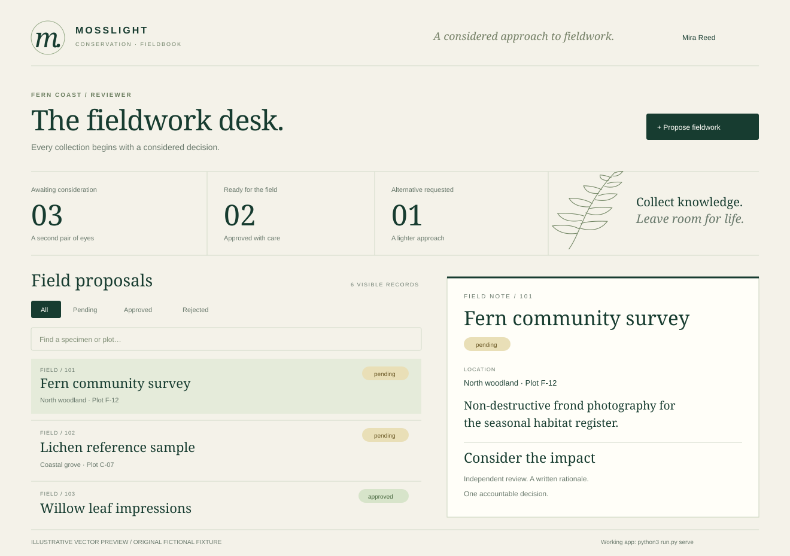

# Mosslight Fieldbook
### Secure Software Delivery Reference Application

**A working specimen-permit application for a fictional conservation nonprofit.** Field researchers propose observations or small collections; independent reviewers record the environmental rationale. Authentication, tenant boundaries and review separation are enforced by the API, not trusted to the dashboard.



**Intended users:** an application-security hiring panel and an engineering lead assessing whether security requirements survive implementation. The product users are Mosslight's fictional field researchers and reviewers.

**My contribution in this portfolio:** application and schema design, Python API, responsive browser workspace, transactional authorization rules, negative HTTP tests, documented threat model, explicit dependency risks and a guarded source-packaging pipeline. This is newly authored portfolio work, not evidence of employment or a deployed conservation system.

## Try it in three minutes

Python 3.10+ with SQLite and OpenSSL support is the only runtime prerequisite. There is no package installation, cloud account, public dataset download or network call during the demo build.

```bash
python3 run.py
python3 run.py serve
```

Open **http://127.0.0.1:8767** exactly. Do not use `localhost`: an exact Host allowlist is part of the exercise. The first command runs the evaluation, builds the evidence exhibit, and generates fresh random local account passwords in `var/demo-credentials.txt`. Passwords are never printed by setup or stored in the fixture. The file is owner-readable on POSIX; Windows permissions depend on the user profile and filesystem.

Use `mira` for the reviewer view or `alba` for the submitter view. Copy that user's generated password from the local file. The app supports sign-in, search, status filters, proposal creation, approvals/rejections, a scoped activity trail and sign-out.

| Account | Team | Role | What to observe |
| --- | --- | --- | --- |
| alba | fern-coast | submitter | Sees only own proposals, can submit fieldwork |
| bram | fern-coast | submitter | A different owner in the same team |
| mira | fern-coast | reviewer | Sees team proposals; cannot review own #106 |
| nico | high-marsh | reviewer | Cannot read or review fern-coast proposals |

For an immediate offline exhibit, open **[docs/index.html](docs/index.html)**. Its role selector explores the fixed sample visibility model; it is labelled as read-only and does not authenticate or change data. The SVG above is an illustrative vector view, not a browser screenshot.

## A five-minute walkthrough

1. Sign in as `alba`, create a fictional photographic survey and sign out.
2. Sign in as `mira`. Select the new proposal, write a rationale and approve it.
3. Select #106, Mira's own observation. The UI explains the independent-review requirement; the API also returns 403 if called directly.
4. Sign in as `nico`. None of Fern Coast's proposals are visible. API requests for them return 404.
5. Read [control-report.md](docs/control-report.md), then connect each conclusion to a named HTTP test in [evaluation.json](docs/evaluation.json).

## Reproduce and assess

```bash
python3 -m unittest discover -s tests -v
python3 run.py verify
python3 run.py package
```

The 25 current API tests use ephemeral ports, isolated SQLite copies and actual HTTP requests, including negative authentication, CSRF, Host, tenant, object, role, SQL-injection, input and concurrent-review cases. `run.py verify` rebuilds the machine-readable observations and executive report. Assertions are deterministic; password salts, runtime credentials, session tokens and operational timestamps intentionally are not. Re-running setup preserves an existing local database and local credentials. For a fresh lab, extract the repo into a new directory.

`run.py package` produces `dist/mosslight-fieldbook-source.zip` and `dist/SHA256SUMS`. The allowlisted source archive excludes local credentials, SQLite databases, caches and environment files. With unchanged source and reports, consecutive packages have the same digest. The GitHub Actions workflow runs checks and packaging on a three-version Python matrix. Remote CI has not been executed for this delivered folder; branch protection must be configured by its eventual repository owner. The workflow does not publish or deploy anything.

## Design evidence

- [Threat model and trust boundaries](docs/threat-model.md) — assets, abuse paths, residual risks and decisions.
- [Architecture diagram](docs/architecture.svg) — request validation and transactional workflow.
- [API contract](docs/openapi.json) — routes, role boundaries, request limits and responses.
- [Design decisions](docs/decisions.md) — PBKDF2 trade-off, opaque sessions, exact-origin policy and SQLite concurrency.
- [Dependency inventory and delivery risks](docs/dependencies.md) — Python, OpenSSL, SQLite, browser and CI are still dependencies.
- [Provenance](data/PROVENANCE.md) and [fixture manifest](docs/fixture-manifest.json) — exact original data and digest.

## Scope and next decisions

This reference demonstrates control implementation and test reasoning, not production certification. Python's local HTTP server is unsuitable for production; TLS and the cookie's Secure flag are absent by explicit local design. There is no account enrollment, MFA, password recovery, durable rate-limit state, immutable audit sink or load/penetration-test assurance. List responses cap at 500 permits and 100 audit events without pagination.

First improvements would replace local password accounts with an identity provider, move request handling to a supported production stack, add browser end-to-end/accessibility tests, and test backup/restore plus a durable audit pipeline. A small nonprofit should not maintain custom identity infrastructure just because this portfolio shows how its pieces work.

Code: MIT. Original fictional fixture: CC0-1.0. No public records or real species coordinates were imported. Public OWASP, Python and GitHub guidance is cited in [docs/sources.md](docs/sources.md).
