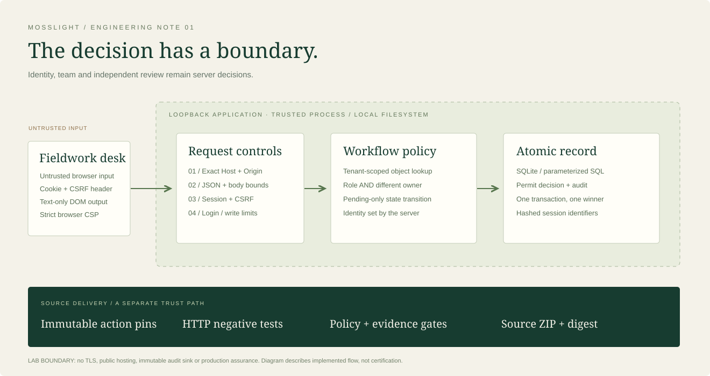

# Threat model: a defensible fieldwork decision

## Scope and assets

The unit of work is a specimen/observation proposal in a fictional tenant. Protect credentials, session authority, tenant confidentiality, review integrity and the link between a decision and its reviewer. The local SQLite file, application source and browser host are trusted. Untrusted inputs include all HTTP fields, purported owners/tenants, proposal text and concurrent requests.

A user may be a malicious submitter, an over-curious reviewer in another tenant, or a victim visiting an unrelated website. A request can bypass the UI. A compromised local machine, trusted reviewer deliberately making a poor decision, denial of service by a local privileged process, and malicious replacement of application code are outside the local control boundary. Those are residual risks, not mitigations.

## Abuse cases and verification

| Abuse path | Decision / implemented control | Concrete evidence | Remaining exposure |
| --- | --- | --- | --- |
| Enumerate another researcher's records | Tenant-scoped query plus ownership condition for submitters; 404 for inaccessible objects | `test_submitter_only_sees_own_objects`, `test_reviewer_can_see_same_tenant_only` | Reviewers intentionally see all proposals in their team |
| Forge tenant, owner or approved status | Strict allowed request fields; identity, tenant and initial state derived server-side | `test_mass_assignment_rejected_and_tenant_set_server_side` | No separate tenant-administration API exists |
| Approve own work or approve without role | Reviewer role AND different owner required | `test_submitter_cannot_review`, `test_reviewer_cannot_approve_own_proposal` | A tenant with one reviewer cannot approve that reviewer's work; identity delegation is intentionally absent |
| Repeat/concurrently change a decision | Guarded `UPDATE ... WHERE status='pending'`; audit in same transaction | `test_duplicate_and_concurrent_review_have_one_winner` | No reversal workflow; erroneous approvals require a future audited amendment design |
| Cross-site POST or DNS rebinding | Exact Origin on every POST including login; Fetch Metadata when present; exact Host; synchronizer CSRF for authenticated mutations; no CORS | Origin, Fetch-Site, Host and CSRF HTTP tests | XSS on the same origin can issue valid requests; proxy hosting requires design changes |
| Steal a session from SQLite | Store SHA-256 of a 256-bit random token, not the raw cookie | `test_session_secret_hashed_in_database` | Local credential-file access compromises demo accounts; DB readers see CSRF but lack raw session token |
| Reuse an expired/revoked/fixed token | Absolute 30-minute expiry; logout deletion; fresh token and CSRF after sign-in | Expiry, logout and rotation tests | No idle timeout or global device-revocation UI; at most five sessions per account |
| Inject SQL or execute proposal markup | Parameterized SQL; JSON data; UI writes user data through `textContent`; no inline script allowed by CSP | SQL payload and script-string tests | Browser exploit execution is not covered by the unit/integration suite |
| Abuse login or overload input | IP and normalized-username rate windows; 16 KiB body cap; field bounds; five-second socket timeout; 16 concurrent handlers | Login-rate and invalid-input tests; code inspection for concurrency cap/timeouts | In-memory limits reset on restart; distributed attacks and sustained load are untested |
| Alter audit evidence | Successful login/logout/submission/review stored with actor, tenant, time and object | Decision+audit and tenant-audit tests | SQLite owner can modify history; no external append-only sink; denied events are not persisted |
| Leak tokens through build outputs | Runtime state ignored and excluded by source allowlist; narrow credential patterns; read-only CI token; immutable action pins | Packaging gates and archive exclusion checks | Pattern scanner misses unrecognized secrets; CI runner and upstream action compromise remain possible |

## Reviewer decision

The local demonstration is suitable for explaining enforcement and inspecting its code. It should not be exposed to a network or given real field locations. Before funding production work, require managed identity, TLS and a supported web stack, explicit audit-retention requirements, backup restoration evidence, independent browser testing and a deployment threat model. Shipping this local server unchanged would skip those decisions.
